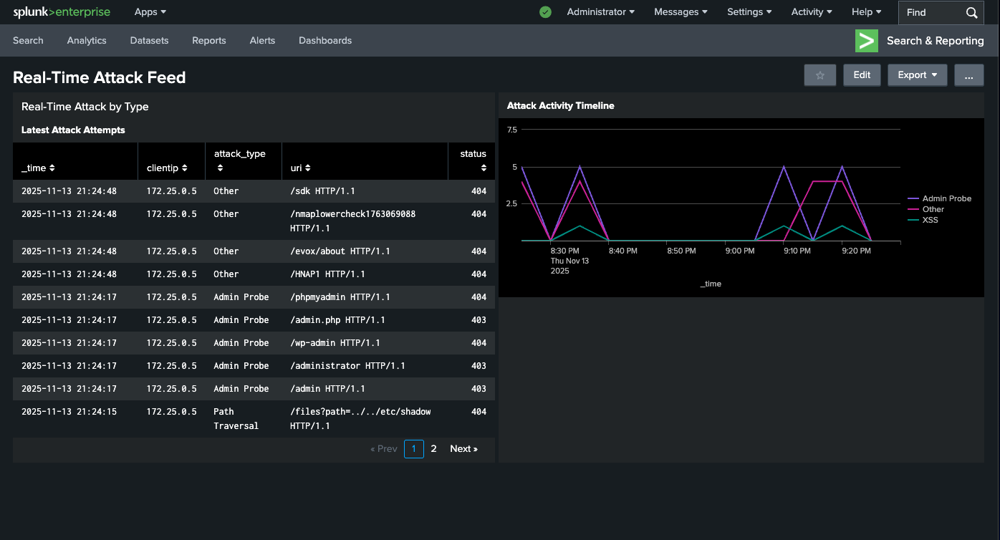
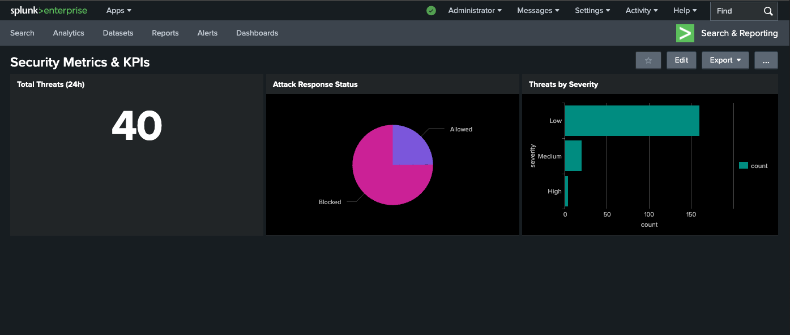
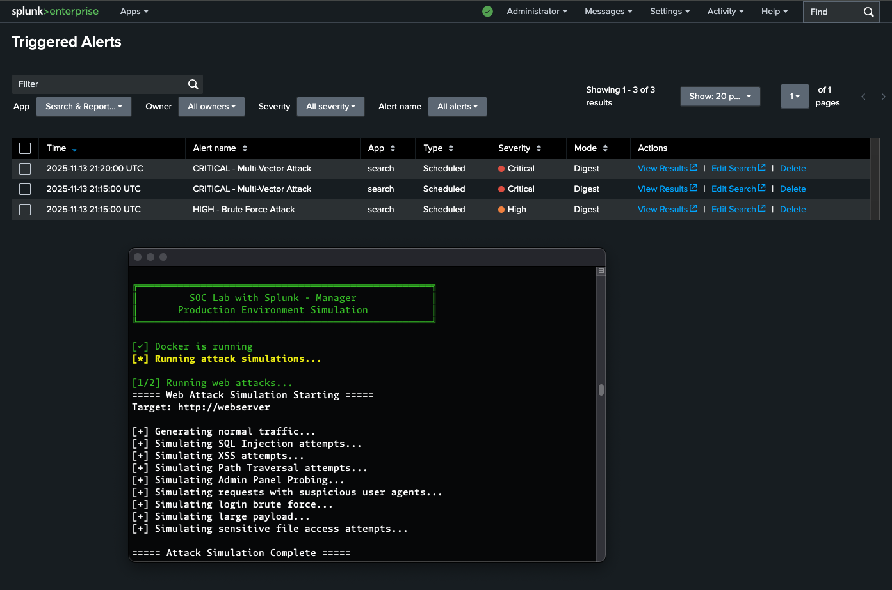
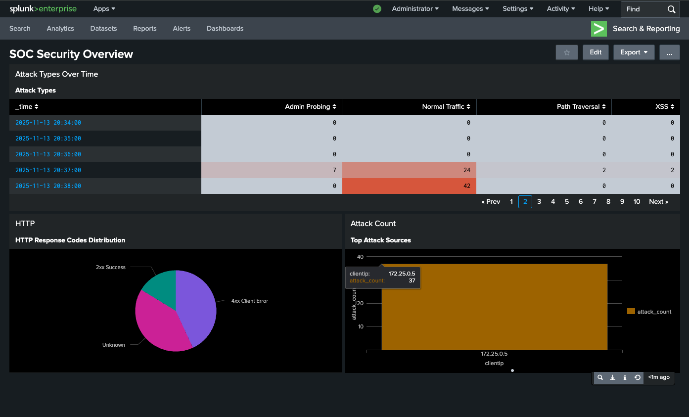

# SOC Lab Splunk

This is a small security lab I built to learn how a SOC works in practice.

The goal was simple: run a few services, generate logs, simulate attacks, and see everything show up in Splunk dashboards and alerts.

This is not a production environment. It is a learning lab for SIEM, monitoring, and basic threat detection.

---

## What this project does

This lab includes:

- Splunk running in Docker
- Nginx as a web server
- MySQL as a database service
- Syslog for centralized logging
- Kali Linux used to simulate attacks
- Alert rules for suspicious activity
- Dashboards to visualize traffic and security events

The idea is to make security data visible and understandable.

---

## Why I built it

I wanted to understand how a real SOC actually works.

Not just from reading theory, but by doing it:

- collecting logs
- sending them to Splunk
- watching live attack traffic
- creating alerts
- checking dashboards for patterns

It became a practical way to learn SIEM and security monitoring.

---

## Screenshots

### Attack feed


### Security KPIs


### Triggered alerts


### SOC overview


---

## Architecture

```text
+---------------------------+
|       Splunk SIEM         |
+---------------------------+
             |
             | logs / events
             v
+-----------+   +-----------+   +----------------+
|   Nginx   |   |   MySQL   |   | Syslog Server  |
| Web app   |   | Database  |   | Central logs   |
+-----------+   +-----------+   +----------------+
             \        |        /
              \       |       /
                 +-----+-----+
                       |
                       v
                +-------------+
                | Kali Linux  |
                | Attacker    |
                +-------------+
```

---

## What it detects

This lab includes examples of common attack patterns:

1. SQL injection
2. Cross-site scripting (XSS)
3. Brute force attempts
4. Admin panel probing
5. Multi-vector attack correlation

These are basic examples, but they are useful for learning how detection rules work in practice.

---

## Results

In this setup, I was able to:

- collect thousands of security events
- detect multiple attack attempts
- build dashboards for monitoring activity
- use Splunk to spot suspicious behavior

It is a hands-on lab, not a production-grade security stack.

---

## Tech stack

- Splunk Enterprise
- Splunk Universal Forwarder
- Docker and Docker Compose
- Nginx
- MySQL
- Syslog
- Kali Linux
- Shell scripting

---

## Quick start

### Requirements

- Docker Desktop
- At least 8GB RAM
- About 20GB of free disk space

### Start the lab

```bash
git clone https://github.com/yourusername/soc-lab-splunk.git
cd soc-lab-splunk
docker-compose up -d
```

Wait a few minutes for Splunk to start.

```bash
docker logs -f splunk-enterprise
```

Then open:

```text
http://localhost:8000
```

Login:

- Username: admin
- Password: ChangeMe123!

### Run the attack simulation

```bash
./lab.sh attacks
```

Then check the Splunk dashboards and alerts.

---

## Project structure

```text
soc-lab/
├── docker-compose.yml
├── configs/
│   ├── splunk/
│   ├── nginx/
│   └── mysql/
├── attack-scripts/
│   ├── web-attacks.sh
│   ├── network-scan.sh
│   └── brute-force.sh
├── dashboards/
│   ├── soc-overview.xml
│   ├── attack-feed.xml
│   └── security-kpis.xml
├── alerts/
│   └── detection-rules.conf
├── screenshots/
├── docs/
│   ├── README.md
│   ├── SETUP-GUIDE.md
│   └── DETECTION-GUIDE.md
└── lab.sh
```

---

## Why this matters

This project helped me connect theory with real practice.

I could see how logs become security signals, how alerts are triggered, and how dashboards help you understand what is happening.

That is the part that makes cybersecurity feel real.

---

## Important note

This lab is for learning and testing in a contained environment only.

Do not run it against real systems without permission.

---

## Contributing

If you want to improve it, you can add:

- more attack scenarios
- more detection rules
- better dashboards
- cleaner documentation

---

## Contact

Luís Barros

- LinkedIn: https://linkedin.com/in/-luis-barros
- Email: luisdbarros98@gmail.com

---

## Final note

This was one of the best ways for me to learn security monitoring.

It made the theory feel real instead of just reading about it.

If you are trying to learn Splunk, SIEM basics, or SOC workflows, this is a good place to start.
